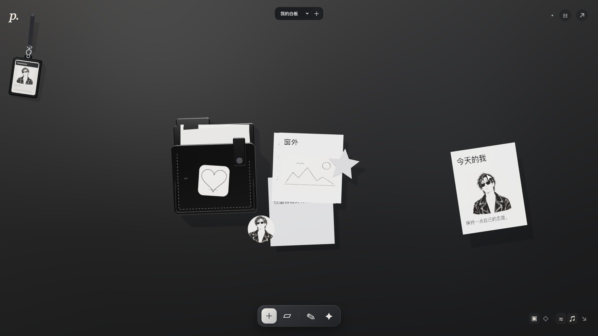
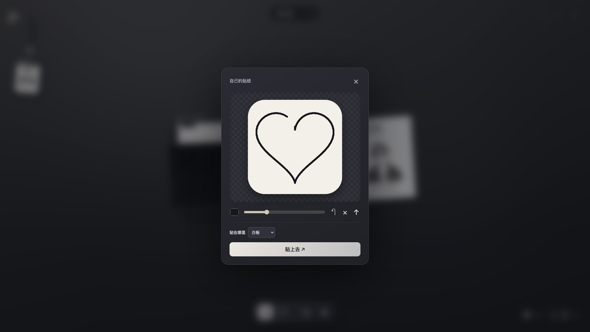

# 纸间 Paperroom

黑色皮革风格的 Three.js 白板笔记应用。便签、文件夹、手绘贴纸在一张有质感的皮面上自由生长。

**[▶ 在线体验](https://haha362636-coder.github.io/paperroom/)** · **[⬇ 下载 Mac 版](../../releases/latest)** · **[🎬 宣传片](../../releases/latest)** · [官网](https://nuoyannotebook.xyz)



同一套代码有两个形态：浏览器里直接打开的网页版（`dist/`），以及用 Swift + WKWebView 包起来的 Apple Silicon 桌面版（`desktop/`）。

## 下载与使用

- **网页版**：打开上面的「在线体验」即可，无需安装。需要支持 WebGL 的浏览器，笔记保存在当前浏览器里。
- **Mac 桌面版**：到 [Releases](../../releases/latest) 下载 `Paperroom-1.1.0-mac-arm64.dmg`，打开后把 Paperroom 拖进「应用程序」。仅支持 Apple Silicon、macOS 14 及以上。
  - 安装包为 ad-hoc 签名，未经 Apple 公证。第一次打开被系统拦下时，到「系统设置 → 隐私与安全性」底部点「仍要打开」。
- 两个版本的数据互相独立，都不跨设备同步。换设备前请用右上角 ↗ 导出 JSON 备份。



## 功能

支持创建和编辑便签、绘制简笔画、录音磁带、拖动笔记/文件夹/贴纸/磁带、袋口吸附动画与 Web Audio 合成扣合音效、文件夹收纳和取回、微风效果、本机自动保存和 JSON 备份导出。

## 快速开始

```bash
npm install          # 只有一个依赖：three
npm run dev          # 启动本地服务，打开 http://127.0.0.1:4173
npm test             # 运行测试
npm run check        # JavaScript 语法检查
```

数据仅保存在当前浏览器的 localStorage，不跨设备同步。音效在首次点击或拖动后启用，可关闭。渲染支持 reduced-motion 偏好。

## 质感与空间交互

默认只显示图标工具栏；文字列表由右上角按钮展开。点击皮质文件夹，内容以真实三维纸张浮起，超过 6 张时可以翻组，点击纸张编辑，关闭时回落。自制贴纸支持手绘、笔刷颜色和粗细、撤销、清空与本机图片导入，能够附着在文件夹上、随其拖动，并持久保存。已有笔记数据保持兼容。

## 录音磁带

点底部工具栏的磁带按钮（或按 R）录一盘磁带：对着麦克风说话，模拟指针式 VU 表跟着音量摆动，小磁带的带盘一边转、一边把磁带从左盘卷到右盘。录完可以试听、重录，在标签上写名字、挑外壳颜色，然后「贴上去」。

白板上的磁带是按真实盒式磁带尺寸（100.4 × 63.8 × 12 mm）建的三维模型：上下两半外壳之间的合模缝、带窗口镂空的纸标签、印着刻度的透明窗、带六个驱动齿的白色带芯、五颗十字螺丝、磁头开口梯形台和防误抹缺口都有。可以随意拖动，拿起时会翘起、随手势摆动，放下时落回皮面并发出塑料壳的轻响。点一下开始播放：两个带盘按 4.76 cm/s 的恒定线速度转动（空盘转得比满盘快），磁带随进度从左盘绕到右盘；拖进度条或点 « 时带盘会快速卷带。

录音保存在当前浏览器的 IndexedDB 里（体积太大，不放 localStorage），白板里只记磁带的标签、颜色、位置和时长；导出备份会把录音一起打包进 JSON。单盘最长 15 分钟，每块白板最多 40 盘。录音需要麦克风权限，网页版需要 https 或本机地址。

## 便签细节

每张便签顶部压着一条纸胶带，普通便签带淡淡的横线，底部印着最后修改日期和字数。编辑器底部显示「创建于 / 修改于」和实时字数。旧笔记没有时间记录，第一次修改后开始记录。

## 自动保存与工牌

编辑笔记时输入停止 350ms 自动保存，关闭编辑器、页面隐藏或离开时立即写入；正文无标题时会自动提取标题。数据保存在当前浏览器和地址对应的本机存储中，并保留上一份有效备份用于损坏恢复；不会跨浏览器或跨设备同步。存储失败会明确提示，不会显示保存成功。

左上角独立三维挂绳工牌使用固定步长绳段约束、重力、阻尼和释放惯性；支持鼠标、触摸拖动及键盘方向键，并尊重减少动态效果偏好。

## 光照与材质

使用 Three.js 物理材质、环境反射和两组矩形柔光灯，黑色皮面采用低强度微纹理和清漆高光。后期渲染加入 SSAO 接触阴影与 MSAA 多重采样抗锯齿；文件夹展开时关闭 SSAO，避免浮层遮罩影响画面。

黑白人物插画由内置 imagegen 生成，用于工牌、人物便签和头像贴纸。素材：`dist/assets/ink-portrait.png`；生成提示词：`dist/assets/ink-portrait-prompt.txt`。

## 多白板工作台

Three.js 以全窗口画布渲染连续黑色皮面。顶部选择当前白板，旁边 ＋ 新建空白白板。各块白板独立保存笔记、文件夹、贴纸和偏好，并记住最后打开的一块。原单白板数据自动迁入“我的白板”，原始快照保留；导出备份包含所有白板。数据依然仅保存在本机当前浏览器。

吊牌使用全窗口透明渲染层，只在命中卡牌时拦截拖动，避免旧局部画布裁切及遮挡白板交互；挂绳支持渐进拉伸与释放回缩，微风按钮同时控制纸张与吊牌，减少动态效果偏好下停用风摆。

纸面使用 1536 × 1800 纹理，正文和标题加大并加深墨色。主画布按 1.5–2.5 倍像素密度渲染，使用 MSAA 保留笔画边缘，避免 FXAA 对细字的柔化。

## 目录结构

```
dist/                    网页版应用（纯静态，可直接托管）
  index.html
  app.js                 主逻辑
  scene.js               Three.js 场景
  state.js               数据模型
  workspace.js           多白板工作台
  lanyard.js             挂绳工牌
  sticker-studio.js      手绘贴纸
  cassette.js            三维磁带模型与带盘动画
  tape-recorder.js       录音、VU 表与磁带标签
  audio-store.js         录音的 IndexedDB 存储
  note-details.js        便签纸面细节与时间显示
  paper-surface.js       纸面与文字排版
  note-layout.js         便签排版
  persistence.js         本机存储
  sound.js               Web Audio 合成音效
  vendor/                three.js（随包分发）
  assets/                插画等静态素材

desktop/                 Apple Silicon 桌面版（Swift + WKWebView）
  main.swift             原生窗口与本地服务（仅绑定 127.0.0.1）
  Info.plist
  build-release.sh       跑测试 → 编译 → ad-hoc 签名 → 出 DMG
  make-icon.sh           从源图生成合规 icns
  tools/build-icon.py    图标预处理
  assets/                图标源图与提示词

tests/                   node:test 测试
```

## Mac 桌面版

仅支持 Apple Silicon、macOS 14+。本地服务只绑定 `127.0.0.1`，笔记数据由 WKWebView 默认数据存储保留，与浏览器版互相独立。

```bash
bash desktop/make-icon.sh       # 生成应用图标（首次构建或换图标时）
bash desktop/build-release.sh   # 跑测试 → 编译 Swift → 签名 → 出 DMG 到 releases/
```

出包使用 ad-hoc 签名，**未经 Apple 公证**。首次打开需要在「系统设置 → 隐私与安全性」里按系统提示允许这一次打开。

### 关于应用图标的一个坑

macOS 26/27 会检查图标**边缘像素的 alpha**：`>= 253` 正常渲染，`<= 252` 就被判定为不合规图标、强制套上一层灰色圆角方框（社区称 gray box / squircle jail）。

AI 生成的图标很容易踩线——不透明区域 alpha 常是 253，而抗锯齿边缘与柔和阴影全是 252 以下的中间值。所以改图标**必须走 `bash desktop/make-icon.sh`**：它会裁掉柔和阴影、用边缘像素外推填满四角，并把所有 alpha 强制为 255，最后校验各尺寸不含中间 alpha。只重跑 `sips` + `iconutil` 是没用的，问题在图内像素本身。

`desktop/assets/icon-fix-before-after.png` 是修复前后的对比图。

## 开源协议

[MIT](LICENSE)

## 支持

遇到问题、想提建议，或者想支持纸间继续做下去：<https://nuoyannotebook.xyz/support.html>
